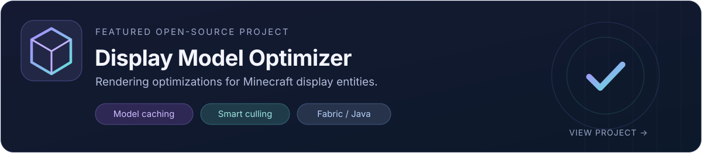

  

   

  

## Hey, I'm Nodelll 👋

I enjoy making software **faster, more practical, and a little more delightful to use**. Right now, I'm especially interested in **Minecraft client-side modding**, rendering optimizations, and tools that automate repetitive work.

Away from the code editor, I'm into **music production, sound design, and audio engineering**. I like the space where technical problem-solving and creativity meet.

### Things I like working on

- 🧩 **Game modding** — building useful features and quality-of-life improvements.
- ⚡ **Performance** — profiling bottlenecks, caching work, and reducing unnecessary rendering.
- 🛠️ **Automation** — turning repetitive tasks into small, reliable tools.
- 🎧 **Audio** — producing music and exploring how sound is made.

## Featured project

**[Display Model Optimizer](https://github.com/Nodelll/display-model-optimizer)** is a client-side Fabric mod that reduces repeated rendering work for Minecraft's `item_display` and `block_display` entities. It includes model caching, draw-group optimizations, configurable display distance, and visibility culling.

[**Source code**](https://github.com/Nodelll/display-model-optimizer) · [**Download releases**](https://github.com/Nodelll/display-model-optimizer/releases) · [**Read the documentation**](https://github.com/Nodelll/display-model-optimizer#readme)

## Tools & technologies

  
  
  
  
  

<strong>На русском</strong>

Привет! Я **Nodelll**. Мне интересно разрабатывать полезные инструменты, модификации Minecraft на Fabric и оптимизировать производительность — в первую очередь рендеринг и клиентскую часть игры.

Также увлекаюсь созданием музыки, саунд-дизайном и звукорежиссурой. Мой открытый проект **[Display Model Optimizer](https://github.com/Nodelll/display-model-optimizer)** помогает уменьшать лишнюю работу при отрисовке `item_display` и `block_display`.

---

  Built with curiosity, tuned for performance. · <a href="https://github.com/Nodelll">@Nodelll</a>

